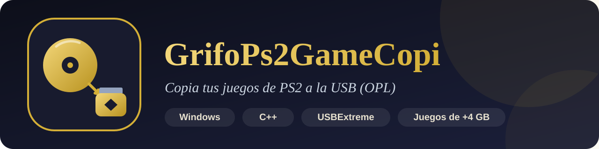
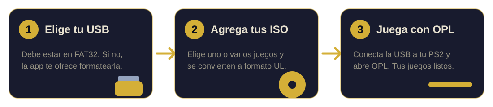

 <p align="center">
  
</p>

<p align="center">
  
  
  
  
  
</p>

<p align="center">
  <b>Una app pequeña, rápida y sin instalación para pasar tus juegos de PS2 a una memoria USB.</b><br>
  Elige la USB, agrega tus ISO y listo para OPL.
</p>

 **Release Descarga:** [Release](https://github.com/novaprpyect/GrifoPs2GameCopiUSB/releases/tag/GrifoPs2GameCopiUSB)
---

## ✨ ¿Qué es?

**GrifoPs2GameCopi** es una aplicación de escritorio para Windows, escrita en C++ con la API de Windows (Win32), que copia tus juegos de PlayStation 2 (archivos `.iso`) a una memoria USB en **formato USBExtreme (UL)**, el que usa **OPL (Open PS2 Loader)**.

Convierte cada ISO a `ul.cfg` + archivos `ul.*` divididos en partes de **1 GiB**, así que funciona con juegos de **más de 4 GB** aunque la memoria esté en FAT32.

No necesita instalar nada, no usa librerías externas y el ejecutable resultante es un solo archivo.

## 🚀 Características

- 💿 **Varios juegos a la vez**: selecciona uno o muchos ISO y se copian en cadena.
- 🧩 **Formato USBExtreme / UL**: `ul.cfg` + partes `ul.*` de hasta 1 GiB, compatible con el formato UL clásico de OPL.
- 🔎 **Lee el ID automáticamente** desde `SYSTEM.CNF` dentro del ISO (por ejemplo `SLUS_200.62`); si no lo encuentra, intenta sacarlo del nombre del archivo.
- 🏷️ **Nombre limpio**: quita `.iso`, el ID repetido y los símbolos prohibidos, y lo recorta a 32 letras como pide OPL.
- 📋 **Lista de juegos** en la memoria, con su ID y su número de partes.
- 🗑️ **Borrar juegos** seleccionados (borra también sus partes y actualiza `ul.cfg`).
- ⚠️ **Detecta si la memoria no es FAT32** y te avisa que *necesita formatear*; si aceptas, la formatea en FAT32 con el formateador propio de GrifoFormat, incluso en memorias de 64 GB o más.
- 🛡️ **Protecciones**: no sobrescribe juegos que ya existen, revisa que haya espacio suficiente y, si algo falla, borra las partes incompletas.
- 📊 **Barra de progreso** y mensajes de estado en vivo.
- 🔒 **Solo USB / removibles**: nunca muestra el disco de Windows.
- 🔌 **Detecta al instante** cuando conectas o quitas una memoria.
- 🪶 **Ligera y portable**: un solo `.exe`, sin instalador ni dependencias.

## 🧭 Cómo se usa

<p align="center">
  
</p>

1. Abre `GrifoPs2GameCopi.exe` (acepta el permiso de administrador).
2. Elige tu memoria en **Unidad USB**. Si no aparece, conéctala y pulsa **Actualizar**.
3. Pulsa **AGREGAR JUEGOS ISO → UL** y selecciona uno o varios `.iso`.
4. Espera a que termine la barra de progreso. Los juegos aparecen en la lista.
5. Conecta la USB a tu PS2 y abre **OPL** para jugar.

Para quitar juegos, selecciónalos en la lista y pulsa **BORRAR**.

> [!WARNING]
> Si tu memoria **no está en FAT32**, la app te lo dirá y te ofrecerá formatearla. **Formatear borra todos los datos** de la memoria y no se puede deshacer, así que respalda antes lo que necesites.

> [!TIP]
> Copia los juegos a la **raíz** de la memoria (la app ya lo hace así): OPL busca `ul.cfg` y los archivos `ul.*` ahí.

## 🧩 ¿Cómo es el formato USBExtreme?

Para cada juego, la app escribe:

| Archivo | Qué es |
|---|---|
| `ul.cfg` | Lista de juegos: un registro de 64 bytes por juego (nombre, ID, número de partes y tipo CD/DVD). |
| `ul.XXXXXXXX.SLUS_200.62.00`, `.01`, `.02`… | Las partes del juego, de hasta 1 GiB cada una. `XXXXXXXX` es el CRC32 del nombre. |

Un juego de 4,3 GB, por ejemplo, queda en 5 partes. Así se evita el límite de 4 GB por archivo de FAT32.

## 🛠️ Compilar

Solo necesitas un compilador de C++ para Windows. El código no requiere enlazar librerías adicionales.

| Compilador | Pasos |
|---|---|
| **Dev-C++ (MinGW)** | Crea un proyecto *Windows Application*, agrega `GrifoPs2GameCopi.cpp` (y `GrifoPs2GameCopi.rc` si quieres el icono) y compila. |
| **MinGW (consola)** | `windres GrifoPs2GameCopi.rc -O coff -o icono.o`<br>`g++ GrifoPs2GameCopi.cpp icono.o -o GrifoPs2GameCopi.exe -mwindows -static` |

> [!NOTE]
> El icono de la ventana se carga del recurso `100` del `.exe`; si no existe, la app intenta cargar `grifo.ico` desde la misma carpeta. Un `.rc` mínimo es: `100 ICON "grifo.ico"`.

## ⚙️ ¿Cómo funciona por dentro?

1. **Analiza el ISO**: lee el descriptor ISO9660, localiza `SYSTEM.CNF` en la raíz y extrae la línea `BOOT2 = cdrom0:\SLUS_200.62;1` para obtener el ID.
2. **Decide el tipo**: ISO de hasta 700 MB se marca como CD; el resto, como DVD.
3. **Divide en partes**: copia el ISO en bloques de 1 MiB hacia archivos `ul.*` de 1 GiB como máximo.
4. **Registra el juego**: agrega el registro de 64 bytes a `ul.cfg` solo cuando todas las partes se copiaron bien.
5. **Formateo (si hace falta)**: bloquea y desmonta la unidad y escribe directamente el sector de arranque, las tablas FAT y la etiqueta `PS2`.

## ⚠️ Limitaciones y preguntas frecuentes

<details>
<summary><b>¿Por qué pide permisos de administrador?</b></summary>

Solo para poder formatear la memoria a FAT32 cuando hace falta. Windows únicamente permite escribir directamente en una unidad con permisos elevados.
</details>

<details>
<summary><b>Me dice que no encontró el ID del juego</b></summary>

El ISO puede estar dañado o no ser de PS2. Si el nombre del archivo incluye el ID (por ejemplo `SLUS_200.62`), la app lo usa como plan B.
</details>

<details>
<summary><b>Me dice que el juego ya existe</b></summary>

Ya hay en `ul.cfg` un juego con ese nombre o ese ID. Bórralo primero desde la lista si quieres volver a copiarlo.
</details>

<details>
<summary><b>¿Cuántos juegos puedo copiar a la vez?</b></summary>

Hasta 64 ISO por selección, y la lista muestra hasta 400 juegos de la memoria.
</details>

<details>
<summary><b>La memoria no aparece en la lista</b></summary>

Conéctala y pulsa **Actualizar**. Solo se muestran memorias USB o unidades removibles.
</details>

<details>
<summary><b>¿Qué versión de Windows necesito?</b></summary>

Se recomienda Windows 10 u 11.
</details>

> [!NOTE]
> Usa esta herramienta solo con copias de seguridad de juegos que tú posees.

## 📁 Estructura del repositorio

```text
GrifoPs2GameCopi/
├─ GrifoPs2GameCopi.cpp   # Código fuente de la aplicación
├─ GrifoPs2GameCopi.rc    # (opcional) Recurso que pone el icono al .exe
├─ grifo.ico              # Icono de la aplicación
├─ README.md
└─ assets/
   ├─ banner.svg          # Cabecera del README
   └─ como-funciona.svg   # Diagrama de uso
```

## 👤 Creador

**xyvenqorix** · 🌐 [xyvenqorix.vercel.app](https://xyvenqorix.vercel.app) · 📱 +53 56639178

## 📄 Licencia 

Distribuido bajo la licencia **MIT**. Agrega un archivo `LICENSE` con el texto de la licencia y tu nombre.
